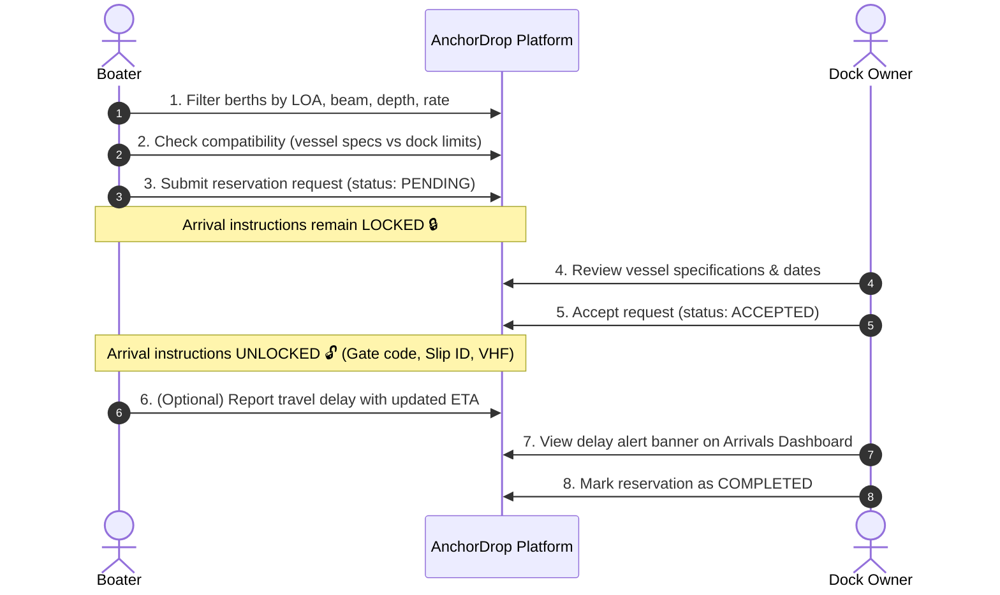

# AnchorDrop — Your Place on the Water!
> *Discover. Dock. Unwind.*

AnchorDrop is a two-sided web marketplace purpose-built for temporary and overnight boat docking. It connects boaters seeking compatible berths with private dock hosts and commercial marina operators monetizing vacant slips.

---

## 1. Locked Technology Stack (Production v1)

| Layer | Technology | Version | Purpose |
| :--- | :--- | :--- | :--- |
| **Framework** | **Next.js (App Router)** | `15.x` | Unified frontend pages and API Route Handlers |
| **Language** | **TypeScript** | `5.x` | Strict type safety for vessels, docks, and bookings |
| **UI Library** | **React** | `19.x` | Component-based dashboards and marketplace UI |
| **Database** | **MongoDB** | `7.x / Memory Server` | Persistent document store with dev memory fallback |
| **Auth** | **JWT + bcryptjs Cookies** | — | Role-based authorization (`boater`, `dock_owner`) |
| **Validation** | **Zod** | — | Server-side schema validation |
| **Channel** | **Web Portal Only** | — | Responsive browser app (mobile, tablet, desktop) |
| **Dev Port** | `http://localhost:3000` | — | Zero third-party business API keys required |

> [!NOTE]
> All 25 master plan phases are fully implemented. Zero external third-party API keys (Stripe, Google Maps, Twilio) are required for v1. The system features an embedded in-memory MongoDB fallback that activates automatically when local MongoDB port 27017 is offline.

---

## 2. Brand Tokens & Design System

- **Deep Navy** (`#0B1F33`): Primary brand color, headers, primary buttons, trust.
- **Champagne Gold** (`#C6A56B`): Accents, borders, highlights, CTA accents.
- **Warm Hover** (`#D8BD91`): Interactive hover and focus warm state.
- **Cream** (`#F5F1E8`): Canvas background, soft panels.
- **Pure White** (`#FFFFFF`): Card surfaces on cream, modal surfaces, inputs.
- **Headings**: Georgia (serif).
- **Body / Interface**: Clean modern sans-serif (system font stack).
- **Headline**: *Your Place on the Water!*
- **Tagline**: *Discover. Dock. Unwind.*
- **WCAG Compliance**: Mathematically verified contrast ratios exceeding WCAG 2.1 AA/AAA standards (Navy on Cream: 14.8:1, Navy on Gold: 7.15:1).

---

## 3. Seeded Demo Accounts (1-Click Login Ready)

Run `npm run seed` to seed realistic demo accounts with bcrypt passwords:

| Role | Account Name | Email | Password | Context |
| :--- | :--- | :--- | :--- | :--- |
| **Boater** | Captain Alex Vance | `boater@anchordrop.com` | `password123` | 2 vessels (*Sea Breeze II* 42ft, *Island Runner* 28ft), active bookings |
| **Dock Host** | Marina Del Sol Harbor | `owner@anchordrop.com` | `password123` | Commercial marina with 3 deepwater slips, pending & accepted requests |
| **Private Host** | Sarah Jenkins | `sarah@anchordrop.com` | `password123` | Residential Fort Lauderdale canal dock, 1 deepwater slip |

*(The auth modal and login screen provide 1-click quick login buttons prefilled with these credentials).*

---

## 4. Two-Sided Marketplace Lifecycle



---

## 5. Development & Testing Workflow

```powershell
# 1. Install dependencies
npm install

# 2. Seed database with demo accounts, vessels, docks, and bookings
npm run seed

# 3. Run master automated regression suite (all 25 sub-suites)
npm test

# 4. Run TypeScript compilation check
npx tsc --noEmit

# 5. Run ESLint code quality check
npm run lint

# 6. Build production Next.js application (32 routes compiled)
npm run build

# 7. Start local development server (http://localhost:3000)
npm run dev
```

---

## 6. Documentation Index

Detailed planning, architecture specifications, and verification checklists live in [`docs/`](./docs):

- [`01 — Problem Statement & Solution Approach`](./docs/01-problem-statement-and-solution.md)
- [`02 — Features & Problem-Solution Mapping`](./docs/02-features-and-solutions.md)
- [`03 — Technical Start Document`](./docs/03-technical-start.md)
- [`04 — Solution Approach`](./docs/04-solution-approach.md)
- [`05 — Backend Plan`](./docs/05-backend-plan.md)
- [`06 — Frontend Plan`](./docs/06-frontend-plan.md)
- [`07 — Combined Project Structure`](./docs/07-combined-project-structure.md)
- [`08 — Master Execution Plan (Phases 1–25)`](./docs/08-master-plan.md)
- [`Smoke & Release Verification Checklist`](./docs/smoke-checklist.md)
- [`Diagrams (PlantUML)`](./docs/diagrams/) *(Architecture, Use Cases, Booking Sequence, Data Model)*

---

© 2026 AnchorDrop. All rights reserved.
